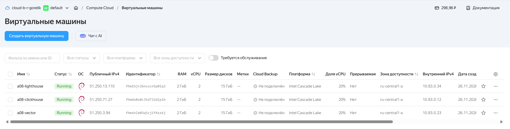
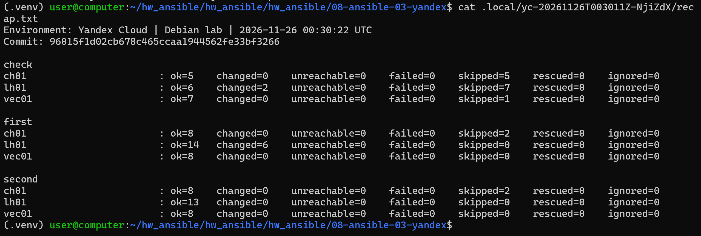

## ДЗ "Использование Ansible: ClickHouse, Vector и LightHouse в Yandex Cloud" Борис Горелик

[Playbook](site.yml) настраивает три отдельные ВМ Debian 12 x86_64. Vector читает тестовую строку из файла и отправляет её в ClickHouse. Браузер открывает LightHouse через SSH-туннель и обращается к базе через Nginx. Открывать в интернет HTTP-порты или нативный порт ClickHouse не нужно.

### Фактически выполненные проверки

Тестовый стенд: три отдельных Debian 12 amd64 в QEMU, настоящий SSH и systemd. Использовался тот же `prod.yml`: переменные адресов указывали на локальные SSH-алиасы, а порт назначения ClickHouse был переопределён на `18123` для проброса QEMU. Проверки не имитировались. ВМ в Yandex Cloud из этой среды не создавались, и результатов облачного прогона пока нет.

| Проверка | ClickHouse | Vector | LightHouse |
|---|---:|---:|---:|
| Прогноз `--check --diff`, changed | 1 | 1 | 2 |
| Первый `--diff`, changed | 6 | 6 | 7 |
| Повторный `--diff`, changed | 0 | 0 | 0 |

Во всех трёх прогонах на каждом узле `failed=0`, `unreachable=0`; [вывод PLAY RECAP](verification.txt) сохранён без округления или пересчёта. Линтер `ansible-lint 25.9.2` для `site.yml` выдал 0 ошибок и 0 предупреждений; `--syntax-check` прошёл. Nginx вернул страницу с `<title>LightHouse</title>`, а запрос через `/clickhouse/` вернул строку `ansible-lab-ready`, доставленную Vector.

### Что делает каждый play

| Группа / тег | Результат |
|---|---|
| `clickhouse` | Устанавливает сервер и клиент из репозитория Debian; включает службу, настраивает IPv4 и создаёт базу `logs` с таблицей `events(message String)`, только если их ещё нет. |
| `vector` | Скачивает закреплённый DEB с проверкой SHA-256, валидирует YAML перед заменой конфига и включает службу. Источник: `/var/log/vector-lab.log`; назначение: `logs.events`. |
| `lighthouse` | Устанавливает Nginx, скачивает и проверяет архив [VKCOM/LightHouse](https://github.com/VKCOM/lighthouse), распаковывает статику в каталог с SHA коммита, отключает стандартный сайт и применяет [шаблон Nginx](templates/lighthouse.conf.j2). Проверяет `nginx -t`, заголовок страницы и ответ на `SELECT 1` через прокси. |

Порядок первого запуска: ClickHouse, затем Vector, затем LightHouse.

